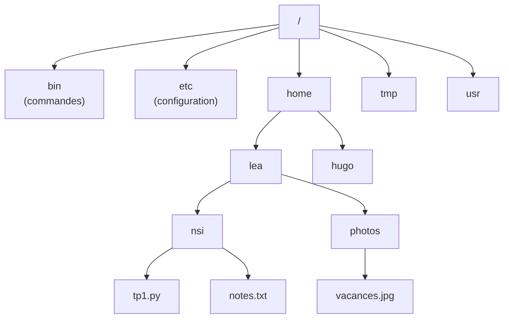

Avant les interfaces graphiques, on pilotait un ordinateur en tapant des **commandes** ; c'est toujours ainsi qu'on administre la plupart des
serveurs, qu'on automatise des tâches répétitives et qu'on travaille à distance. Le **shell** (interpréteur de commandes : `bash`, `zsh`…)
lit une commande, la fait exécuter par le système (en créant un processus) et affiche le résultat. Le programme de première NSI demande de
savoir utiliser les commandes de base ; cette leçon les présente avec l'organisation des fichiers qu'elles manipulent.

## 1. L'arborescence

Sous Unix (Linux, macOS, Android), tous les fichiers sont rangés dans **un seul arbre** dont la racine s'appelle `/`. Les disques, clés USB
et partages réseau y sont **montés** comme des sous-répertoires.



:::definition
- Le **chemin absolu** d'un fichier part de la racine : `/home/lea/nsi/tp1.py`.
- Le **répertoire courant** est celui « où l'on se trouve » (`pwd` l'affiche). Un **chemin relatif** part de lui : depuis `/home/lea`,
  `nsi/tp1.py` désigne le même fichier.
- `.` désigne le répertoire courant, `..` son parent, `~` le répertoire personnel. Depuis `/home/lea/nsi`, `../photos/vacances.jpg`
  remonte d'un cran puis redescend.
:::

```python exec
import posixpath   # la gestion des chemins façon Unix, sans toucher au disque

courant = "/home/lea/nsi"
for chemin in ["tp1.py", "../photos/vacances.jpg", "./../../hugo", "/etc/../tmp/./x", "~"]:
    complet = chemin if chemin.startswith("/") else posixpath.join(courant, chemin)
    print(f"{chemin:25} → {posixpath.normpath(complet)}")
```

(Le dernier montre que `~` n'est pas un vrai nom de répertoire : c'est le **shell** qui le remplace par `/home/lea` avant d'exécuter la
commande ; `normpath` ne le connaît pas.)

## 2. Les commandes de base

| Commande | Rôle | Exemple |
|---|---|---|
| `pwd` | affiche le répertoire courant | `pwd` → `/home/lea` |
| `ls` | liste un répertoire (`-l` détaillé, `-a` fichiers cachés) | `ls -l nsi` |
| `cd` | change de répertoire | `cd nsi`, `cd ..`, `cd` (retour à `~`) |
| `mkdir` | crée un répertoire | `mkdir -p projets/jeu` |
| `touch` | crée un fichier vide (ou met à jour sa date) | `touch notes.txt` |
| `cp` | copie (`-r` pour un répertoire) | `cp tp1.py tp1_sauvegarde.py` |
| `mv` | déplace ou renomme | `mv tp1.py tp_final.py` |
| `rm` | supprime (`-r` récursif) — **sans corbeille** | `rm brouillon.txt` |
| `cat`, `less` | affiche un fichier (en entier, page par page) | `cat notes.txt` |
| `head`, `tail` | premières, dernières lignes (`-n 5`) | `tail -n 20 journal.log` |
| `grep` | lignes contenant un motif (`-i` sans casse, `-c` compte, `-r` récursif) | `grep -n def tp1.py` |
| `wc` | compte lignes, mots, octets (`-l` lignes) | `wc -l notes.txt` |
| `find` | cherche des fichiers dans un arbre | `find ~ -name "*.py"` |
| `echo` | affiche un texte | `echo "bonjour"` |
| `man` | manuel d'une commande | `man grep` |

Le shell développe les **motifs** avant d'exécuter : `*.py` est remplacé par la liste des fichiers du répertoire courant qui finissent par
`.py` ; `?` remplace un caractère.

:::attention
`rm` est **définitif** : pas de corbeille. Et `rm -r *` dans le mauvais répertoire efface tout ce qu'on a le droit d'effacer. Toujours
vérifier avec `pwd` et `ls` avant une suppression récursive.
:::

## 3. Redirections et tubes

Chaque processus a trois flux : l'**entrée standard** (clavier par défaut), la **sortie standard** (écran) et la **sortie d'erreur** (écran).
Le shell peut les rediriger :

```text
ls -l > liste.txt            # sortie vers un fichier (écrase)
echo "fin" >> liste.txt      # ajoute à la fin
sort < noms.txt              # entrée lue dans un fichier
python3 prog.py 2> erreurs.txt   # sortie d'erreur vers un fichier
cat journal.log | grep ERREUR | wc -l      # tube : combien de lignes d'erreur ?
```

```mermaid legende="Un tube relie la sortie d'un processus à l'entrée du suivant"
flowchart LR
  F[("journal.log")] --> C["cat"]
  C -->|"|"| G["grep ERREUR"]
  G -->|"|"| W["wc -l"]
  W --> E(["écran : 42"])
```

C'est la **philosophie Unix** : de petits programmes qui font une seule chose bien, et qu'on combine. Chaque commande d'un tube est un
processus distinct ; ils s'exécutent **en même temps**, le système transmettant les données au fil de l'eau.

```python exec
# Le même traitement en Python : cat journal | grep ERREUR | wc -l
journal = """09:00 INFO démarrage
09:01 ERREUR disque plein
09:02 INFO nouvelle connexion
09:05 ERREUR délai dépassé
09:07 INFO arrêt"""
lignes = journal.splitlines()                    # cat
erreurs = [l for l in lignes if "ERREUR" in l]   # grep ERREUR
print(len(erreurs))                              # wc -l
```

## 4. Ce qu'est un fichier pour le système

Sous Unix, un fichier est décrit par un **inode** : taille, propriétaire, groupe, droits, dates, et l'emplacement de ses blocs sur le disque.
Le **nom** n'est pas dans l'inode : un **répertoire** est un fichier spécial qui associe des noms à des numéros d'inode. Un même inode peut
donc avoir plusieurs noms (**liens physiques**, `ln`) ; un **lien symbolique** (`ln -s`) est un petit fichier qui contient un chemin. Le
système de fichiers garde aussi la liste des blocs libres ; supprimer un fichier retire son nom du répertoire et libère ses blocs quand plus
aucun nom ne le désigne.

Presque tout est vu comme un fichier : les périphériques (`/dev/sda` pour un disque), les informations sur les processus (`/proc`). C'est
une abstraction du système d'exploitation : les mêmes appels `open`, `read`, `write` servent partout.

:::prof
Le programme de première NSI demande d'« utiliser les commandes de base en ligne de commande ». Sans installer Linux, plusieurs solutions :
une distribution en ligne (terminal dans le navigateur), le jeu « Terminus » (aventure textuelle en commandes shell), WSL sous Windows, ou
le terminal d'un Raspberry Pi. Faire construire l'arborescence d'un petit « projet » avec `mkdir`, `touch`, `mv` puis la dessiner fait le
lien avec les arbres. Attention à `rm` en classe : utiliser un compte et un dossier d'exercice dédiés.
:::

## Exemple guidé

**Problème.** Dans un dossier `tp/` contenant les rendus des élèves (`nom_tp3.py`), on veut : (1) savoir combien de rendus ont été déposés,
(2) lister ceux qui contiennent encore `input(`, (3) les copier dans un dossier `a_revoir/`.

**1. Compter.** `ls tp/*_tp3.py | wc -l` : le shell développe le motif, `ls` affiche un fichier par ligne quand sa sortie va dans un tube,
`wc -l` compte les lignes.

**2. Chercher.** `grep -l "input(" tp/*_tp3.py` : l'option `-l` affiche seulement les **noms** des fichiers qui contiennent le motif.

**3. Copier.** `mkdir -p a_revoir` puis `cp $(grep -l "input(" tp/*_tp3.py) a_revoir/` : `$(…)` remplace la commande par sa sortie (la
liste des fichiers). On peut aussi utiliser `xargs` : `grep -l "input(" tp/*_tp3.py | xargs cp -t a_revoir/`.

**4. La même chose en Python**, pour comparer :

```python exec
import os, glob, shutil

os.makedirs("tp", exist_ok=True)                       # on fabrique un exemple
for nom, code in [("lea", "x = 3\nprint(x)"), ("hugo", "x = int(input())\nprint(x)"), ("ines", "n = input('n ? ')")]:
    with open(f"tp/{nom}_tp3.py", "w") as f:
        f.write(code)

rendus = sorted(glob.glob("tp/*_tp3.py"))
print(len(rendus), "rendus")
a_revoir = [r for r in rendus if "input(" in open(r).read()]
print("à revoir :", a_revoir)
os.makedirs("a_revoir", exist_ok=True)
for r in a_revoir:
    shutil.copy(r, "a_revoir/")
print(sorted(os.listdir("a_revoir")))
```

Le shell est imbattable pour ces enchaînements courts ; Python devient préférable dès qu'il y a de la logique (conditions complexes,
calculs, rapports).

## L'essentiel

- Un seul arbre de racine `/` ; chemins absolus (depuis `/`) et relatifs (depuis le répertoire courant) ; `.`, `..`, `~`.
- Commandes : `pwd`, `ls`, `cd`, `mkdir`, `touch`, `cp`, `mv`, `rm` (définitif !), `cat`, `head`, `tail`, `grep`, `wc`, `find`, `echo`, `man`.
- Motifs `*`, `?` développés par le shell ; redirections `>` (écrase), `>>` (ajoute), `<`, `2>` ; tubes `|` entre processus.
- Fichier = inode (métadonnées et blocs) ; répertoire = table nom → inode ; liens physiques et symboliques ; « tout est fichier ».

## Exercices

::::exercice[Chemin relatif]{niveau=1}
On est dans `/home/lea/nsi`. Quel chemin relatif désigne `/home/hugo/projet` ?

- [ ] `hugo/projet`
- [ ] `../hugo/projet`
- [x] `../../hugo/projet`
- [ ] `/hugo/projet`

:::corrige
`..` remonte à `/home/lea`, un second `..` à `/home`, puis on descend dans `hugo/projet`. `/hugo/projet` est un chemin **absolu** (depuis la
racine), qui n'existe pas.
:::
::::

::::exercice[Redirection]{niveau=1}
Le fichier `liste.txt` contient 10 lignes. Après `echo "fin" > liste.txt`, combien de lignes contient-il ?

- [x] 1
- [ ] 10
- [ ] 11
- [ ] 0

:::corrige
`>` **écrase** le fichier : il ne contient plus que « fin ». Pour ajouter une onzième ligne, il fallait `>>`.
:::
::::

::::exercice[Normaliser un chemin]{niveau=2}
Sans utiliser `posixpath` ni `os.path`, écris `absolu(courant, chemin)` qui renvoie le chemin absolu normalisé correspondant à `chemin`
(absolu ou relatif au répertoire `courant`, lui-même absolu), en traitant `.`, `..` et les `/` multiples. Remonter au-dessus de la racine
reste sur la racine.

```python depart
def absolu(courant, chemin):
    ...
```

```python tests
assert absolu("/home/lea/nsi", "tp1.py") == "/home/lea/nsi/tp1.py", "relatif simple"
assert absolu("/home/lea/nsi", "../photos/./a.jpg") == "/home/lea/photos/a.jpg", "parent et point"
assert absolu("/home/lea", "/etc//ssh/../hosts") == "/etc/hosts", "absolu à normaliser"
assert absolu("/home", "../../..") == "/", "au-dessus de la racine"
assert absolu("/", ".") == "/", "racine"
```

:::corrige
```python solution
def absolu(courant, chemin):
    depart = [] if chemin.startswith("/") else courant.split("/")
    pile = []
    for morceau in depart + chemin.split("/"):
        if morceau in ("", "."):
            continue
        if morceau == "..":
            if pile:
                pile.pop()
        else:
            pile.append(morceau)
    return "/" + "/".join(pile)
```
Une **pile** des répertoires traversés : un nom empile, `..` dépile, `.` et les morceaux vides (dus aux `/` doublés) ne font rien. C'est
exactement ce que fait le noyau en résolvant un chemin, répertoire par répertoire.
:::
::::

::::exercice[Un mini grep et wc]{niveau=2}
Écris `grep(motif, texte, options="")` qui renvoie la liste des lignes de `texte` contenant `motif` ; l'option `"i"` ignore la casse,
l'option `"v"` inverse la sélection (lignes qui ne contiennent **pas** le motif). Puis `wc_l(lignes)` qui renvoie leur nombre.

```python depart
def grep(motif, texte, options=""):
    ...

def wc_l(lignes):
    ...
```

```python tests
t = "Erreur disque\ninfo ok\nERREUR réseau\nfin"
assert grep("Erreur", t) == ["Erreur disque"], "sensible à la casse"
assert grep("erreur", t, "i") == ["Erreur disque", "ERREUR réseau"], "option i"
assert grep("erreur", t, "iv") == ["info ok", "fin"], "options i et v"
assert wc_l(grep("e", t)) == 2, "tube grep | wc -l"
```

:::corrige
```python solution
def grep(motif, texte, options=""):
    resultat = []
    for ligne in texte.splitlines():
        if "i" in options:
            trouve = motif.lower() in ligne.lower()
        else:
            trouve = motif in ligne
        if trouve != ("v" in options):
            resultat.append(ligne)
    return resultat

def wc_l(lignes):
    return len(lignes)
```
`trouve != inverse` vaut `trouve` sans l'option `v` et `not trouve` avec : un ou exclusif. Composer `wc_l(grep(…))` imite le tube
`grep … | wc -l`.
:::
::::

::::exercice[Un find récursif]{niveau=3}
Une arborescence est représentée par des dictionnaires imbriqués : un répertoire est un `dict` (nom → contenu), un fichier est une chaîne
(son contenu). Écris `find(arbre, suffixe, chemin="")` qui renvoie la liste **triée** des chemins (à partir de `chemin`, séparés par `/`)
des fichiers dont le nom se termine par `suffixe`.

```python depart
def find(arbre, suffixe, chemin=""):
    ...
```

```python tests
racine = {"home": {"lea": {"nsi": {"tp1.py": "...", "notes.txt": "..."}, "jeu.py": "..."},
                   "hugo": {"a.py": "...", "vide": {}}},
          "etc": {"hosts": "..."}}
assert find(racine, ".py") == ["/home/hugo/a.py", "/home/lea/jeu.py", "/home/lea/nsi/tp1.py"], "tous les .py"
assert find(racine, ".txt") == ["/home/lea/nsi/notes.txt"], "un seul"
assert find(racine["etc"], ".py", "/etc") == [], "aucun"
```

:::corrige
```python solution
def find(arbre, suffixe, chemin=""):
    resultats = []
    for nom, contenu in arbre.items():
        sous_chemin = chemin + "/" + nom
        if isinstance(contenu, dict):
            resultats.extend(find(contenu, suffixe, sous_chemin))
        elif nom.endswith(suffixe):
            resultats.append(sous_chemin)
    return sorted(resultats)
```
Un parcours en profondeur de l'arbre : les répertoires sont les nœuds internes, les fichiers les feuilles. La vraie commande `find` fait
la même chose sur le disque (avec `os.walk` en Python).
:::
::::

::::exercice[Préparer une séance « ligne de commande »]{niveau=4 duree=25}
Vous préparez une première séance de shell en première NSI, sur un serveur Linux du lycée où chaque élève a un compte.

1. Écrivez une suite de 6 à 8 commandes que les élèves exécutent pour créer l'arborescence `~/nsi/tp_shell/{donnees,resultats}`, y créer un
   fichier `donnees/notes.csv` contenant trois lignes (avec `echo` et des redirections), l'afficher, compter ses lignes et en copier les
   lignes contenant « Léa » dans `resultats/lea.csv`.
2. Expliquez pour chaque commande un piège fréquent chez les élèves.
3. Comment évaluer ce qu'ils ont retenu sans simple QCM ?

:::criteres
- Suite de commandes correcte : `mkdir -p ~/nsi/tp_shell/donnees ~/nsi/tp_shell/resultats` (ou en plusieurs fois), `cd`, `echo … > donnees/notes.csv` puis `>>`, `cat`, `wc -l`, `grep Léa donnees/notes.csv > resultats/lea.csv`.
- Pièges pertinents : chemin relatif depuis le mauvais répertoire, `>` au lieu de `>>`, espaces dans les noms et guillemets, `mkdir` sans `-p`, majuscules, oubli que `rm` est définitif.
- Évaluation : tâche à réaliser (arborescence à reproduire, défi « retrouver un fichier »), explication d'une commande, prédiction de sortie, trace de l'historique (`history`).
:::

:::corrige
1. ```text
   mkdir -p ~/nsi/tp_shell/donnees ~/nsi/tp_shell/resultats
   cd ~/nsi/tp_shell
   echo "nom;note" > donnees/notes.csv
   echo "Léa;15" >> donnees/notes.csv
   echo "Hugo;12" >> donnees/notes.csv
   cat donnees/notes.csv
   wc -l donnees/notes.csv
   grep "Léa" donnees/notes.csv > resultats/lea.csv
   ```
2. `mkdir -p` : sans `-p`, la création échoue si `nsi` n'existe pas encore. `cd` : oublier où l'on est, d'où des chemins relatifs faux —
   prendre l'habitude de `pwd`. Premier `echo … >` puis `>>` : utiliser `>` à chaque ligne écrase les précédentes (fichier d'une seule ligne).
   Les guillemets : sans eux, `;` est interprété par le shell comme un **séparateur de commandes** (`echo Léa;15` exécute `echo Léa` puis la
   commande `15`, inexistante). `wc -l` compte les **sauts de ligne**, en-tête compris (3 ici). `grep` est sensible à la casse et aux
   accents. Et dans toutes les commandes : un espace oublié ou en trop (`cd..`, `rm -r * .txt`).
3. Une tâche finale « à réaliser » : reproduire une arborescence donnée par un schéma, ou un défi « retrouve le fichier qui contient le mot
   secret quelque part sous `~/defi` » (`find`, `grep -r`) ; demander de **prédire** la sortie d'une suite de commandes avant de l'exécuter ;
   faire expliquer à l'oral une commande de l'historique (`history`) ; vérifier le résultat sur leurs comptes (arborescence et contenu des
   fichiers).
:::
::::
