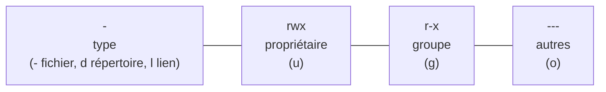

Un même ordinateur (ou un serveur du lycée) est utilisé par plusieurs personnes et fait tourner des services : chacun doit pouvoir
travailler sans lire les copies du voisin ni casser le système. Le système d'exploitation identifie donc des **utilisateurs**, les regroupe
en **groupes**, et contrôle chaque accès à un fichier selon des **droits**. C'est le troisième rôle d'un système : **protéger**.

## 1. Utilisateurs et groupes

Chaque utilisateur a un nom et un numéro (**UID**), un répertoire personnel, un shell ; il appartient à un **groupe principal** et
éventuellement à d'autres groupes (`profs`, `eleves_tg1`…). La commande `id` les affiche. Un utilisateur particulier, **root** (UID 0),
l'**administrateur**, a tous les droits. On ne travaille pas en root au quotidien : on utilise `sudo commande` pour exécuter une seule
commande avec ses droits, ce qui est journalisé.

Les **processus** appartiennent à l'utilisateur qui les a lancés et ont **ses** droits : un programme lancé par Léa ne peut faire que ce que
Léa peut faire.

## 2. Les droits d'un fichier

```text
$ ls -l
-rwxr-x---  1 lea  profs   2048 oct. 12 10:31 corrige.py
drwxr-xr-x  2 lea  lea     4096 oct. 12 09:02 public
-rw-r--r--  1 hugo eleves   512 oct. 11 17:45 notes.txt
```



| Lettre | Sur un fichier | Sur un répertoire |
|---|---|---|
| `r` (read) | lire le contenu | lister les noms qu'il contient |
| `w` (write) | modifier le contenu | créer, renommer, **supprimer** des fichiers dedans |
| `x` (execute) | l'exécuter comme programme | le **traverser** (y entrer, atteindre ce qu'il contient) |

:::retenir[Qui a quels droits ?]
Le système regarde **une seule** catégorie : si l'utilisateur est le **propriétaire**, ce sont les droits du propriétaire ; sinon, s'il
appartient au **groupe** du fichier, ceux du groupe ; sinon, ceux des **autres**. Conséquence surprenante : avec `----rwxrwx`, le
propriétaire n'a **aucun** droit, même si tout le monde en a. (root, lui, passe outre.)
:::

:::attention
Supprimer un fichier est une opération sur le **répertoire** qui le contient : il faut le droit `w` sur le répertoire, pas sur le fichier.
On peut donc supprimer un fichier en lecture seule s'il est dans son propre répertoire.
:::

## 3. Modifier les droits : chmod et chown

**Notation symbolique** : `chmod` qui (`u`, `g`, `o`, `a`), opération (`+`, `-`, `=`), droits (`r`, `w`, `x`).

```text
chmod u+x script.sh          # le propriétaire peut l'exécuter
chmod go-w rapport.txt       # le groupe et les autres ne peuvent plus écrire
chmod a=r affiche.txt        # tout le monde en lecture seule
```

**Notation octale** : chaque triplet est un nombre de 0 à 7, somme de $r = 4$, $w = 2$, $x = 1$ (les trois bits du triplet, en binaire).

```python exec
def vers_octal(droits):
    """'rwxr-x---' → '750'"""
    chiffres = ""
    for i in range(0, 9, 3):
        triplet = droits[i:i + 3]
        valeur = 4 * (triplet[0] == "r") + 2 * (triplet[1] == "w") + 1 * (triplet[2] == "x")
        chiffres += str(valeur)
    return chiffres

for d in ["rwxr-x---", "rw-r--r--", "rwxr-xr-x", "rw-------"]:
    print(d, "→", vers_octal(d))
print(oct(0b111_101_000))      # les droits sont bien 9 bits : 0o750
```

`chown hugo:profs fichier` change le propriétaire et le groupe (réservé à root pour le propriétaire). La valeur par défaut des droits d'un
nouveau fichier est réglée par le **umask** (souvent `022` : on retire l'écriture au groupe et aux autres, d'où `644` pour un fichier,
`755` pour un répertoire).

## 4. Gérer les ressources

Le système contrôle aussi la **consommation** : quotas d'espace disque par utilisateur, limites sur le nombre de processus ou la mémoire
(`ulimit`), priorité des processus (`nice`, `renice`), surveillance (`top`, `df -h` pour l'espace des disques, `du -sh` pour la taille d'un
dossier). Sur un serveur partagé, ces limites empêchent qu'un programme qui s'emballe (boucle qui crée des processus, fichier qui grossit
sans fin) ne rende la machine inutilisable pour tous.

:::methode[Le principe du moindre privilège]
Donner à chaque compte, programme ou service **le minimum** de droits nécessaires : un serveur web tourne sous un utilisateur dédié qui
ne peut lire que les fichiers du site ; les élèves n'ont pas de droit d'écriture dans le dossier des corrigés ; on n'utilise pas un compte
administrateur pour naviguer sur le Web. Si quelque chose est compromis, les dégâts restent limités.
:::

:::prof
Programme de première NSI : « identifier les différents droits », « modifier les permissions d'un fichier ». Sur un serveur Linux de
lycée, une activité classique : chaque binôme crée un fichier, le rend lisible par le groupe de la classe mais pas par les autres, puis
vérifie avec le compte d'un camarade. La notation octale fait le lien avec la numération (chaque chiffre octal = 3 bits). Sous Windows,
les droits passent par des listes de contrôle d'accès (ACL), plus fines mais plus complexes.
:::

## Exemple guidé

**Problème.** Un dossier de projet `/srv/projet` doit être modifiable par les élèves du groupe `tg1` et lisible (mais pas modifiable) par
le professeur `prof`, qui n'est pas dans le groupe ; les autres ne doivent rien voir. Le propriétaire est `prof`.

**1. Identifier les catégories.** Propriétaire : `prof` ; groupe : `tg1` ; autres : tout le reste.

**2. Choisir les droits du répertoire.** Pour `tg1` : lister, créer, traverser → `rwx` (7). Pour `prof`, propriétaire : lire et traverser,
**sans écrire** → `r-x` (5). Pour les autres : rien → `---` (0). D'où `chmod 570 /srv/projet` et `chown prof:tg1 /srv/projet`.

**3. Vérifier par le raisonnement.** Le professeur est le propriétaire : seuls les droits du propriétaire comptent (`r-x`) ; il peut lister
et lire, pas créer. Un élève de `tg1` (pas propriétaire, dans le groupe) a `rwx`. Un élève de `tg2` tombe dans « autres » : `---`.

```python exec
def peut(utilisateur, groupes, proprietaire, groupe, droits, action):
    """droits : 9 caractères ; action : 'r', 'w' ou 'x'."""
    if utilisateur == "root":
        return True
    if utilisateur == proprietaire:
        triplet = droits[0:3]
    elif groupe in groupes:
        triplet = droits[3:6]
    else:
        triplet = droits[6:9]
    return action in triplet

d = "r-xrwx---"   # 570
print(peut("prof", ["profs"], "prof", "tg1", d, "w"))      # False : le prof ne peut pas écrire
print(peut("lea", ["tg1"], "prof", "tg1", d, "w"))         # True
print(peut("hugo", ["tg2"], "prof", "tg1", d, "r"))        # False
```

**4. Discuter.** La situation est inhabituelle (propriétaire moins puissant que le groupe) : il serait plus naturel de faire appartenir le
répertoire à un compte de service et de donner les droits au professeur par un second groupe, ou d'utiliser des ACL (`setfacl`).

## L'essentiel

- Utilisateurs (UID), groupes, root (UID 0) ; `sudo` pour une action administrateur ponctuelle ; un processus a les droits de son utilisateur.
- Droits `rwx` pour propriétaire / groupe / autres ; une seule catégorie s'applique (propriétaire, sinon groupe, sinon autres).
- Sur un répertoire : `r` lister, `w` créer/supprimer dedans, `x` traverser.
- `chmod` symbolique (`u+x`, `go-w`, `a=r`) ou octal (`r=4, w=2, x=1` : `755`, `644`, `700`) ; `chown` ; `umask`.
- Ressources : quotas, `ulimit`, `nice`, `top`, `df`, `du` ; principe du **moindre privilège**.

## Exercices

::::exercice[Lire des droits]{niveau=1}
`-rw-r-----  1 lea profs  …  bilan.txt`. Hugo n'est pas dans le groupe `profs`. Que peut-il faire avec ce fichier ?

- [ ] le lire seulement
- [ ] le lire et le modifier
- [x] rien
- [ ] le supprimer, car il n'a pas de droit d'écriture

:::corrige
Hugo n'est ni le propriétaire ni dans le groupe : il relève des « autres », qui ont `---`. (La suppression dépendrait des droits du
répertoire, pas de ceux du fichier.)
:::
::::

::::exercice[Notation octale]{niveau=1}
Quel `chmod` donne `rwxr-xr--` ?

- [ ] `chmod 755`
- [x] `chmod 754`
- [ ] `chmod 644`
- [ ] `chmod 574`

:::corrige
`rwx` = 4+2+1 = 7, `r-x` = 4+1 = 5, `r--` = 4 : 754.
:::
::::

::::exercice[Conversions]{niveau=2}
Écris `octal_vers_lettres(code)` qui transforme une chaîne de trois chiffres octaux (`"750"`) en notation `rwx` sur 9 caractères
(`"rwxr-x---"`), et `lettres_vers_octal(droits)` qui fait l'inverse.

```python depart
def octal_vers_lettres(code):
    ...

def lettres_vers_octal(droits):
    ...
```

```python tests
assert octal_vers_lettres("750") == "rwxr-x---", "750"
assert octal_vers_lettres("644") == "rw-r--r--", "644"
assert octal_vers_lettres("000") == "---------", "aucun droit"
assert lettres_vers_octal("rwxr-xr-x") == "755", "755"
assert all(lettres_vers_octal(octal_vers_lettres(f"{a}{b}{c}")) == f"{a}{b}{c}"
           for a in range(8) for b in range(8) for c in range(8)), "aller-retour sur les 512 valeurs"
```

:::corrige
```python solution
def octal_vers_lettres(code):
    resultat = ""
    for chiffre in code:
        v = int(chiffre)
        resultat += ("r" if v & 4 else "-") + ("w" if v & 2 else "-") + ("x" if v & 1 else "-")
    return resultat

def lettres_vers_octal(droits):
    code = ""
    for i in range(0, 9, 3):
        t = droits[i:i + 3]
        code += str(4 * (t[0] == "r") + 2 * (t[1] == "w") + (t[2] == "x"))
    return code
```
Chaque chiffre octal code exactement trois bits : `v & 4` teste le bit de lecture, `v & 2` l'écriture, `v & 1` l'exécution.
:::
::::

::::exercice[Peut-il accéder ?]{niveau=2}
Écris `acces(utilisateur, groupes_utilisateur, fichier, action)` où `fichier` est un dictionnaire avec les clés `"proprietaire"`,
`"groupe"` et `"droits"` (9 caractères), et `action` vaut `"r"`, `"w"` ou `"x"`. Applique la règle « une seule catégorie » ; root a tous
les droits.

```python depart
def acces(utilisateur, groupes_utilisateur, fichier, action):
    ...
```

```python tests
f = {"proprietaire": "lea", "groupe": "profs", "droits": "rwxr-x---"}
assert acces("lea", ["eleves"], f, "w"), "propriétaire"
assert acces("ines", ["profs"], f, "x") and not acces("ines", ["profs"], f, "w"), "groupe"
assert not acces("hugo", ["eleves"], f, "r"), "autres"
assert acces("root", [], f, "w"), "root"
g = {"proprietaire": "lea", "groupe": "profs", "droits": "---rwxrwx"}
assert not acces("lea", ["profs"], g, "r"), "le propriétaire n'hérite pas des droits du groupe"
```

:::corrige
```python solution
def acces(utilisateur, groupes_utilisateur, fichier, action):
    if utilisateur == "root":
        return True
    d = fichier["droits"]
    if utilisateur == fichier["proprietaire"]:
        triplet = d[0:3]
    elif fichier["groupe"] in groupes_utilisateur:
        triplet = d[3:6]
    else:
        triplet = d[6:9]
    return action in triplet
```
Le dernier test est le piège classique : Léa, propriétaire, est aussi dans le groupe `profs`, mais seuls les droits du propriétaire
comptent pour elle (`---`).
:::
::::

::::exercice[Appliquer un chmod symbolique]{niveau=3}
Écris `chmod(droits, expression)` qui applique une expression symbolique à une chaîne de 9 caractères et renvoie la nouvelle chaîne.
L'expression est une liste de clauses séparées par des virgules, chacune de la forme `qui` (lettres parmi `ugoa`) + opérateur (`+`, `-`
ou `=`) + droits (lettres parmi `rwx`, éventuellement aucune pour `=`).

```python depart
def chmod(droits, expression):
    ...
```

```python tests
assert chmod("rw-r--r--", "u+x") == "rwxr--r--", "ajout"
assert chmod("rwxrwxrwx", "go-w") == "rwxr-xr-x", "retrait pour deux catégories"
assert chmod("rwxr-xr-x", "a=r") == "r--r--r--", "affectation pour tous"
assert chmod("rwxr-x---", "u-x,g+w,o=") == "rw-rwx---", "plusieurs clauses"
assert chmod("---------", "a+rx,u+w") == "rwxr-xr-x", "755 en symbolique"
```

:::corrige
```python solution
def chmod(droits, expression):
    d = list(droits)
    position = {"u": 0, "g": 3, "o": 6}
    rang = {"r": 0, "w": 1, "x": 2}
    for clause in expression.split(","):
        for i, c in enumerate(clause):
            if c in "+-=":
                qui, op, quoi = clause[:i], c, clause[i + 1:]
                break
        if "a" in qui:
            qui = "ugo"
        for categorie in qui:
            base = position[categorie]
            for lettre, r in rang.items():
                if op == "+" and lettre in quoi:
                    d[base + r] = lettre
                elif op == "-" and lettre in quoi:
                    d[base + r] = "-"
                elif op == "=":
                    d[base + r] = lettre if lettre in quoi else "-"
    return "".join(d)
```
`=` remet à zéro les droits **non** cités pour les catégories visées ; `+` et `-` ne touchent que les droits cités. Chaque clause est
appliquée dans l'ordre, sur le résultat de la précédente.
:::
::::

::::exercice[Organiser les droits d'un espace partagé]{niveau=4 duree=20}
Sur le serveur du lycée, vous voulez un dossier `/srv/rendus/tg1` où : chaque élève de TG1 dépose son rendu ; un élève ne peut ni lire ni
modifier ni supprimer le rendu d'un autre ; vous (compte `prof`) pouvez tout lire.

1. Pourquoi les droits Unix « simples » (un propriétaire, un groupe) rendent-ils ce besoin délicat ? Montrez qu'un `chmod 770` avec le
   groupe `tg1` ne convient pas.
2. Proposez une solution (droits du dossier, droits des fichiers déposés, éventuellement bit spécial ou autre mécanisme) et justifiez-la.
3. Quelle solution plus simple, sans serveur partagé, utiliseriez-vous en pratique, et que perd-on ?

:::criteres
- Analyse : avec 770 et groupe tg1, tout élève du groupe peut lister, lire (si les fichiers sont lisibles par le groupe) et surtout supprimer les fichiers des autres (droit w sur le répertoire).
- Solution cohérente : dossier en `rwx-wx---` ou `1730` (sticky bit qui interdit de supprimer les fichiers d'autrui), répertoire sans `r` pour le groupe (pas de listage), fichiers créés en `600` ou `640` avec groupe permettant au professeur de lire (umask, groupe du dossier, ACL `setfacl`), ou dossier personnel par élève.
- Justification de chaque droit (x pour traverser, w pour créer, r retiré pour ne pas lister) ; mention des limites.
- Solution pratique alternative (ENT, plateforme de dépôt, dossiers individuels) et ce qu'on perd (apprentissage du système, contrôle) ou gagne.
:::

:::corrige
1. Avec `drwxrwx--- prof:tg1`, tout élève du groupe a `w` sur le dossier : il peut **supprimer ou renommer** n'importe quel fichier, y compris
   celui d'un camarade (supprimer est une opération sur le répertoire). Avec `r`, il peut aussi **lister** les rendus des autres, et les lire
   si les fichiers sont lisibles par le groupe (umask `022` ou `002` courant). Le modèle « un propriétaire, un groupe » ne sait pas dire
   « chacun ses fichiers dans un dossier commun ».
2. Une solution classique : `chown prof:tg1 /srv/rendus/tg1` et `chmod 1730` : le propriétaire `prof` a `rwx` ; le groupe a `-wx` (créer et
   traverser, **pas lister**) ; les autres rien ; le **sticky bit** (le `1`, affiché `t`) interdit de supprimer ou renommer un fichier dont on
   n'est pas propriétaire (c'est le réglage de `/tmp`). Les élèves déposent leurs fichiers en `600` (lisibles par eux seuls)… mais alors le
   professeur ne peut pas les lire ! Il faut soit qu'ils soient en `640` avec un groupe auquel les autres élèves n'appartiennent pas (le bit
   `setgid` sur le dossier fait hériter le groupe du dossier, à combiner avec un groupe `profs_tg1`), soit une **ACL** par défaut sur le dossier
   (`setfacl -d -m u:prof:r /srv/rendus/tg1`) qui donne au professeur la lecture de tout nouveau fichier. Plus simple encore : un
   **sous-dossier par élève**, en `700` appartenant à l'élève, avec une ACL de lecture pour `prof`.
3. En pratique, la plupart des enseignants utilisent l'**ENT** (casier, devoirs) ou une plateforme de dépôt : les droits sont gérés par
   l'application, avec horodatage et notifications. On y gagne en simplicité et en sûreté ; on y perd l'occasion de travailler concrètement
   les droits Unix avec les élèves — qu'on peut garder pour une activité dédiée sur un dossier d'exercice.
:::
::::
