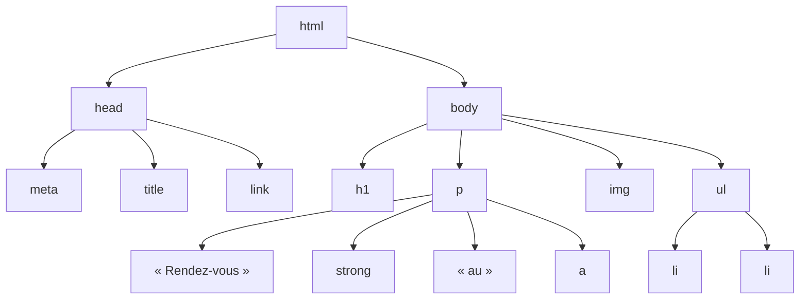

Une page web est un document **texte** que le navigateur transforme en affichage. Deux langages s'y partagent le travail : **HTML**
dit *ce qu'est* chaque morceau de contenu (un titre, une liste, un lien, un champ de saisie), **CSS** dit *comment l'afficher*. Les deux
sont des langages de **description**, pas de programmation : on n'y écrit ni boucles ni conditions. Leur structure, en revanche, est
très informatique : un **arbre**.

## 1. HTML : des balises qui forment un arbre

```html
<!DOCTYPE html>
<html lang="fr">
  <head>
    <meta charset="utf-8">
    <title>Mon club d'astronomie</title>
    <link rel="stylesheet" href="style.css">
  </head>
  <body>
    <h1>Club d'astronomie</h1>
    <p>Rendez-vous <strong>chaque vendredi</strong> au <a href="/plan.html">labo</a>.</p>
    
    <ul>
      <li>Observation</li>
      <li>Photographie</li>
    </ul>
  </body>
</html>
```

:::definition
- Un **élément** HTML s'écrit avec une **balise ouvrante** et une **balise fermante** (`<p>…</p>`), sauf les éléments vides (``,
  `<meta>`, `<br>`, `<input>`). Les balises ouvrantes portent des **attributs** (`href`, `src`, `alt`, `class`, `id`…).
- Les éléments sont **imbriqués** sans se chevaucher : la page est un **arbre**, le **DOM**, dont la racine est `<html>`.
:::



```python exec
from html.parser import HTMLParser

class Arbre(HTMLParser):
    """Affiche l'arbre des balises en indentant selon la profondeur."""
    VIDES = {"meta", "img", "br", "input", "link", "hr"}

    def __init__(self):
        super().__init__()
        self.profondeur = 0

    def handle_starttag(self, balise, attributs):
        print("  " * self.profondeur + balise, dict(attributs) if attributs else "")
        if balise not in self.VIDES:
            self.profondeur += 1

    def handle_endtag(self, balise):
        self.profondeur -= 1

Arbre().feed('<body><h1>Club</h1><p>Le <a href="/plan.html">labo</a></p></body>')
```

### Une page sémantique et accessible

Les balises ont un **sens** : `<h1>`…`<h6>` (titres hiérarchisés), `<p>`, `<ul>`/`<ol>`/`<li>`, `<a>` (lien), `<strong>` (importance),
`<em>` (emphase), `<table>`, et les balises de structure `<header>`, `<nav>`, `<main>`, `<article>`, `<section>`, `<footer>`. Utiliser
la bonne balise (et non un `<div>` stylé pour tout) rend la page lisible par les moteurs de recherche et par les **lecteurs d'écran**
utilisés par les personnes aveugles : c'est une question d'**accessibilité** (obligation légale pour les sites publics en France).

## 2. Les formulaires

```html
<form action="/inscription" method="post">
  <label for="nom">Nom</label>
  <input type="text" id="nom" name="nom" required>

  <label for="niveau">Niveau</label>
  <select id="niveau" name="niveau">
    <option value="2nde">Seconde</option>
    <option value="1re">Première</option>
  </select>

  <input type="checkbox" id="news" name="news" value="oui">
  <label for="news">Recevoir les nouvelles</label>

  <button type="submit">S'inscrire</button>
</form>
```

À l'envoi, le navigateur construit la requête : `nom=Léa&niveau=1re&news=oui` dans le corps (POST) ou après `?` dans l'URL (GET).
L'attribut **`name`** donne la clé ; une case non cochée n'est **pas** envoyée. `required`, `type="email"`, `min`/`max` font une
vérification **côté client**, pratique mais contournable : le serveur doit **toujours** revérifier.

## 3. CSS : des règles

```css
/* sélecteur { propriété: valeur; … } */
body        { font-family: sans-serif; color: #222; }
h1          { color: navy; font-size: 2rem; }
.important  { font-weight: bold; }          /* classe : <p class="important"> */
#menu       { background: #eee; }           /* identifiant : <nav id="menu"> */
nav a       { text-decoration: none; }      /* descendant : un a dans un nav */
a:hover     { text-decoration: underline; } /* pseudo-classe : survol */
```

### La cascade : qui gagne ?

Plusieurs règles peuvent viser le même élément avec des valeurs contradictoires. Le navigateur départage dans cet ordre :

1. l'**importance** et l'origine (`!important`, styles de l'auteur contre ceux du navigateur) ;
2. la **spécificité** du sélecteur ;
3. l'**ordre** d'écriture : à spécificité égale, la **dernière** règle l'emporte.

:::methode[Calculer une spécificité]
On compte un triplet $(a, b, c)$ : $a$ = nombre d'**identifiants** (`#x`), $b$ = nombre de **classes**, d'attributs (`[type=text]`)
et de pseudo-classes (`:hover`), $c$ = nombre d'**éléments** (`p`, `a`) et de pseudo-éléments (`::before`). On compare les triplets
**dans l'ordre lexicographique**. Un attribut `style="…"` dans la balise bat tous les sélecteurs.

| Sélecteur | Spécificité |
|---|---|
| `p` | (0, 0, 1) |
| `nav a` | (0, 0, 2) |
| `.important` | (0, 1, 0) |
| `a:hover` | (0, 1, 1) |
| `#menu a.actif` | (1, 1, 1) |

Une seule classe (0, 1, 0) bat dix éléments (0, 0, 10) : ce n'est pas une somme.
:::

L'**héritage** est un autre mécanisme : certaines propriétés (couleur du texte, police) se transmettent des parents aux enfants dans
l'arbre, d'autres non (bordures, marges).

### Le modèle de boîte

```mermaid legende="Chaque élément est une boîte : contenu, padding, bordure, marge"
flowchart TB
  subgraph M["margin (marge extérieure, transparente)"]
    subgraph B["border (bordure)"]
      subgraph P["padding (marge intérieure, couleur de fond)"]
        C["contenu<br/>width × height"]
      end
    end
  end
```

Par défaut, `width` ne concerne que le contenu : une boîte `width: 200px; padding: 10px; border: 2px solid` occupe **224 px** de large.
Avec `box-sizing: border-box`, la largeur inclut padding et bordure (le contenu fait alors 176 px) — c'est ce qu'utilisent la plupart
des feuilles de style modernes. La disposition générale s'obtient avec **flexbox** (`display: flex`, sur une ligne ou une colonne) et
**grid** (`display: grid`, en grille).

:::prof
En SNT, on fait écrire une page simple, modifier une feuille de style et observer le code source ; en première NSI, le programme
précise « identifier les différents composants graphiques permettant d'interagir avec une application web » et « analyser le
fonctionnement d'un formulaire ». L'inspecteur du navigateur (F12, onglet Éléments) montre l'arbre DOM et, pour chaque élément, les
règles CSS appliquées et **barrées** (perdantes de la cascade) : l'outil idéal pour expliquer la spécificité.
:::

## Exemple guidé

**Problème.** Vérifier qu'un fragment HTML est **bien imbriqué** (chaque balise fermante correspond à la dernière ouverte), en
ignorant les éléments vides.

**1. Reconnaître une pile.** Quand on ouvre une balise, on l'empile ; quand on en ferme une, elle doit être au **sommet**. C'est le même
problème que le parenthésage d'une expression.

**2. Extraire les balises** avec une expression rationnelle : `<(/?)(\w+)[^>]*>` capture la barre éventuelle et le nom.

```python exec
import re

VIDES = {"br", "img", "meta", "input", "link", "hr"}

def bien_imbrique(html):
    pile = []
    for fermante, nom in re.findall(r"<(/?)(\w+)[^>]*>", html):
        nom = nom.lower()
        if nom in VIDES:
            continue
        if not fermante:
            pile.append(nom)
        elif not pile or pile.pop() != nom:
            return False
    return pile == []

print(bien_imbrique("<p>Un <strong>mot</strong> et <em>deux</em></p>"))
print(bien_imbrique("<p>Un <strong>mot</p></strong>"))            # chevauchement
print(bien_imbrique("<ul><li>a<li>b</ul>"))                       # li non fermés
print(bien_imbrique('<p>Ligne<br>suivante </p>'))
```

**3. Limites.** Les navigateurs, eux, **tolèrent** le HTML mal formé (ils réparent l'arbre selon des règles précises de la norme HTML5)
— `<li>` peut même légalement rester ouvert. Un vrai validateur (validator.w3.org) applique toute la grammaire ; notre pile ne vérifie
que l'imbrication. Elle ignore aussi les commentaires et le contenu des `<script>`.

## L'essentiel

- HTML = structure et sens ; CSS = présentation. Éléments, balises, attributs ; éléments vides (`img`, `br`, `input`, `meta`).
- La page est un **arbre** : le DOM. Page minimale : `<!DOCTYPE html>`, `<html lang>`, `<head>` (charset, title), `<body>`.
- Sémantique (`h1`…`h6`, `nav`, `main`, `article`…) et accessibilité (`alt`, `label`, titres hiérarchisés).
- Formulaires : `action`, `method`, champs avec `name` (clé envoyée) ; vérifications côté client contournables.
- CSS : règles `sélecteur { propriété: valeur; }` ; cascade = importance, puis **spécificité** (id, classes, éléments), puis ordre ; héritage.
- Modèle de boîte : contenu, padding, border, margin ; `box-sizing: border-box`.

## Exercices

::::exercice[Quelle règle gagne ?]{niveau=1}
Le paragraphe `<p id="intro" class="note">Bonjour</p>` est visé par ces règles, dans cet ordre. De quelle couleur est-il ?

```css
#intro  { color: red; }
p.note  { color: green; }
.note   { color: blue; }
```

- [x] rouge
- [ ] vert
- [ ] bleu
- [ ] noir, car les règles se contredisent

:::corrige
Spécificités : `#intro` (1, 0, 0), `p.note` (0, 1, 1), `.note` (0, 1, 0). L'identifiant l'emporte quel que soit l'ordre : **rouge**.
:::
::::

::::exercice[Ce qu'envoie un formulaire]{niveau=1}
Un formulaire en GET contient `<input name="ville" value="Lyon">` et `<input type="checkbox" name="pluie" value="oui">` non cochée.
Quelle partie paramètres de l'URL est envoyée ?

- [ ] `?ville=Lyon&pluie=non`
- [x] `?ville=Lyon`
- [ ] `?Lyon`
- [ ] `?ville=Lyon&pluie=`

:::corrige
Une case non cochée n'est pas envoyée du tout. Les champs sont envoyés sous la forme `name=valeur`.
:::
::::

::::exercice[Calculer une spécificité]{niveau=2}
Écris `specificite(selecteur)` qui renvoie le triplet $(a, b, c)$ d'un sélecteur simple composé de mots séparés par des espaces, où
chaque mot est une suite de morceaux : un nom d'élément éventuel en tête (`p`, `nav`), puis des `#id`, `.classe` et `:pseudo-classe`.
On ignore les pseudo-éléments et les attributs.

```python depart
def specificite(selecteur):
    ...
```

```python tests
assert specificite("p") == (0, 0, 1), "élément"
assert specificite("nav a") == (0, 0, 2), "descendant"
assert specificite(".important") == (0, 1, 0), "classe"
assert specificite("a:hover") == (0, 1, 1), "pseudo-classe"
assert specificite("#menu a.actif") == (1, 1, 1), "mixte"
assert specificite("ul#liste li.pair.vu:hover") == (1, 3, 2), "plusieurs morceaux"
```

:::corrige
```python solution
import re

def specificite(selecteur):
    a = b = c = 0
    for mot in selecteur.split():
        for morceau in re.findall(r"[#.:]?[\w-]+", mot):
            if morceau.startswith("#"):
                a += 1
            elif morceau[0] in ".:":
                b += 1
            else:
                c += 1
    return (a, b, c)
```
Chaque morceau commence par son préfixe : `#` → identifiant, `.` ou `:` → classe ou pseudo-classe, rien → élément. Les triplets se
comparent directement en Python (`(1, 0, 0) > (0, 9, 9)`), ce qui reproduit l'ordre lexicographique de la cascade.
:::
::::

::::exercice[Profondeur de l'arbre HTML]{niveau=2}
Écris `profondeur(html)` qui renvoie la profondeur maximale d'imbrication des balises d'un fragment **bien imbriqué** (sans éléments
vides). Un texte sans balise a une profondeur 0 ; `<p>a</p>` a une profondeur 1.

```python depart
import re

def profondeur(html):
    ...
```

```python tests
assert profondeur("texte") == 0, "aucune balise"
assert profondeur("<p>a</p>") == 1, "une balise"
assert profondeur("<div><p>Un <strong>mot</strong></p><p>b</p></div>") == 3, "imbrication"
assert profondeur("<ul><li>a</li><li><em>b</em></li></ul>") == 3, "liste"
```

:::corrige
```python solution
import re

def profondeur(html):
    courante = maximum = 0
    for fermante, _ in re.findall(r"<(/?)(\w+)[^>]*>", html):
        if fermante:
            courante -= 1
        else:
            courante += 1
            maximum = max(maximum, courante)
    return maximum
```
C'est la hauteur de l'arbre DOM (sans compter les textes) : on n'a pas besoin de la pile elle-même, seulement de sa taille.
:::
::::

::::exercice[Le modèle de boîte]{niveau=3}
Écris `largeur_totale(regles)` qui reçoit un dictionnaire de propriétés CSS (valeurs entières en pixels) et renvoie la largeur
**occupée** horizontalement par la boîte, marges comprises. Clés possibles : `width`, `padding`, `border`, `margin` (appliqués des deux
côtés ; absent = 0) et `box-sizing` (`"content-box"` par défaut ou `"border-box"`).

```python depart
def largeur_totale(regles):
    ...
```

```python tests
assert largeur_totale({"width": 200, "padding": 10, "border": 2}) == 224, "content-box"
assert largeur_totale({"width": 200, "padding": 10, "border": 2, "margin": 15}) == 254, "avec marge"
assert largeur_totale({"width": 200, "padding": 10, "border": 2, "box-sizing": "border-box"}) == 200, "border-box"
assert largeur_totale({"width": 100, "margin": 5, "box-sizing": "border-box"}) == 110, "border-box et marge"
```

:::corrige
```python solution
def largeur_totale(regles):
    largeur = regles.get("width", 0)
    padding = regles.get("padding", 0)
    bordure = regles.get("border", 0)
    marge = regles.get("margin", 0)
    if regles.get("box-sizing", "content-box") == "content-box":
        largeur += 2 * (padding + bordure)
    return largeur + 2 * marge
```
En `content-box`, `width` ne mesure que le contenu : on ajoute padding et bordure des deux côtés. En `border-box`, ils sont déjà
inclus. La marge s'ajoute dans les deux cas.
:::
::::

::::exercice[Corriger une page d'élève]{niveau=4 duree=20}
Un élève de SNT a écrit :

```html
<html>
<body>
<div class="titre"><b>Mon exposé sur les réseaux sociaux</b></div>
<div>Voici mon exposé. <font color="red">Attention !</font></div>

<div class="titre"><b>Partie 1</b></div>
<a href="page2.html">Clique ici</a>
</body>
</html>
```

1. Relevez les problèmes (validité, sémantique, accessibilité, séparation fond/forme).
2. Proposez une version corrigée du HTML et la feuille CSS associée.
3. Comment feriez-vous découvrir ces règles aux élèves sans simplement les énoncer ?

:::criteres
- Problèmes : pas de doctype, pas de `<head>`/`<title>`/`charset`, pas de `lang` ; titres en `<div><b>` au lieu de `<h1>`/`<h2>` ; balise obsolète `<font>` (présentation dans le HTML) ; image sans `alt` ; lien « Clique ici » non explicite.
- Version corrigée sémantique (`h1`, `h2`, `p`, `strong` ou `em`, `alt` descriptif, lien explicite) et CSS séparé (couleur, police).
- Démarche pédagogique : lecteur d'écran ou mode lecture, validateur W3C, désactivation du CSS, comparaison, critères co-construits.
:::

:::corrige
1. **Validité** : pas de `<!DOCTYPE html>`, pas de `<head>` avec `<meta charset="utf-8">` et `<title>`, pas de `lang="fr"` ; `<font>`
   est obsolète en HTML5. **Sémantique** : les titres sont des `<div>` en gras au lieu de `<h1>` et `<h2>` (un moteur de recherche ou un
   lecteur d'écran ne voit pas de titres) ; le texte n'est pas dans un `<p>`. **Accessibilité** : image sans `alt` ; lien « Clique ici »
   incompréhensible hors contexte (les lecteurs d'écran listent les liens). **Fond/forme** : couleur et gras écrits dans le HTML.
2. ```html
   <!DOCTYPE html>
   <html lang="fr">
   <head>
     <meta charset="utf-8">
     <title>Les réseaux sociaux — exposé</title>
     <link rel="stylesheet" href="style.css">
   </head>
   <body>
     <h1>Mon exposé sur les réseaux sociaux</h1>
     <p>Voici mon exposé. <strong class="alerte">Attention !</strong></p>
     
     <h2>Partie 1</h2>
     <p><a href="page2.html">Lire la partie 2 : les données personnelles</a></p>
   </body>
   </html>
   ```
   ```css
   body    { font-family: sans-serif; max-width: 45rem; margin: auto; }
   h1, h2  { color: #1d3557; }
   .alerte { color: #c1121f; }
   ```
3. Faire écouter la page avec un **lecteur d'écran** (ou le mode lecture du navigateur) : les élèves constatent qu'il n'y a « aucun
   titre » et une image muette. Passer la page au **validateur du W3C**. **Désactiver le CSS** pour voir que la structure doit rester
   lisible. Comparer avec une page bien construite, puis faire établir par la classe une liste de critères qui servira de grille
   d'auto-évaluation pour le projet.
:::
::::
