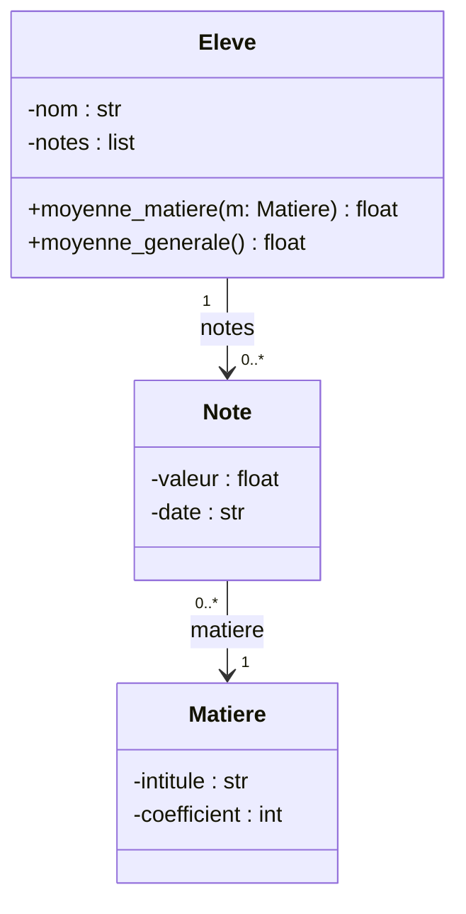

## Présentation du dossier

Un lycée développe un petit logiciel pour produire les **bulletins trimestriels**. Le dossier rassemble les éléments déjà réalisés par l'équipe de développement. Les
parties peuvent être traitées dans l'ordre de votre choix ; les réponses doivent être justifiées et rédigées.

**Document 1 — La base de données** (base `lycee` de l'Atelier, que vous pouvez interroger dans les questions SQL) :

```text
classe  (id_classe, niveau, salle)
eleve   (id_eleve, nom, prenom, naissance, #id_classe)
matiere (id_matiere, intitule, coefficient)
note    (id_note, #id_eleve, #id_matiere, valeur, date_eval)
```

**Document 2 — Une première version, en une seule table**, envisagée puis abandonnée :

```text
releve (id_eleve, nom, prenom, id_classe, salle, intitule_matiere, coefficient, valeur, date_eval)
```

**Document 3 — Le diagramme de classes** du module de calcul :



**Document 4 — Un extrait du code Java** du module d'export :

```java
public static String appreciation(double moyenne) {
    if (moyenne >= 16) return "Félicitations";
    if (moyenne >= 14) return "Compliments";
    if (moyenne > 12) return "Encouragements";
    return "";
}
```

**Document 5 — Le format des identifiants de connexion** des élèves : deux lettres majuscules (initiales), un tiret, puis trois chiffres dont le premier n'est pas 0
(par exemple `LM-142`). Un automate fini déterministe doit valider ces identifiants à la saisie.

**Document 6 — Les tâches du serveur** la nuit du conseil de classe (durées en minutes, toutes disponibles à 0 h) : sauvegarde de la base (S, 30), calcul des moyennes
(C, 10), génération des PDF (G, 40), envoi des notifications aux familles (N, 5).

## Partie 1 — Les données

::::exercice[Dépendances fonctionnelles]{niveau=4 duree=20}
À partir du document 2 :
1. Donnez quatre dépendances fonctionnelles de la relation `releve`.
2. Expliquez, sur des exemples tirés du lycée, deux anomalies auxquelles cette table conduit.
3. Montrez que le schéma du document 1 élimine ces anomalies.

:::criteres
- Dépendances : `id_eleve → nom, prenom, id_classe` ; `id_classe → salle` ; `intitule_matiere → coefficient` ; (`id_eleve`, `intitule_matiere`, `date_eval`) `→ valeur` (ou équivalent).
- Anomalies concrètes : changement de salle d'une classe à reporter sur toutes les lignes de tous ses élèves (mise à jour) ; coefficient répété et incohérent ; impossible d'enregistrer un élève sans note (insertion) ; suppression de la dernière note d'un élève qui fait disparaître l'élève.
- Le document 1 range chaque fait une seule fois, relié par des clés étrangères.
:::

:::corrige
1. `id_eleve → nom, prenom, id_classe` ; `id_classe → salle` ; `intitule_matiere → coefficient` ; et la valeur dépend de l'élève, de la matière et de l'évaluation :
   `(id_eleve, intitule_matiere, date_eval) → valeur` (en supposant une évaluation par matière et par date).
2. **Mise à jour** : si la classe 1G2 change de salle, il faut modifier toutes les lignes de toutes les notes de tous ses élèves ; un oubli rend la base incohérente.
   **Insertion** : un nouvel élève sans note ne peut pas être enregistré (il n'a pas de ligne). **Suppression** : supprimer la seule note d'un élève fait disparaître
   l'élève. Et le coefficient d'une matière, répété sur chaque note, peut devenir contradictoire.
3. Dans le document 1, chaque fait est stocké **une seule fois** : la salle dans `classe`, l'identité dans `eleve`, le coefficient dans `matiere` ; `note` ne contient que
   les clés étrangères et la valeur. Chaque dépendance part d'une clé : le schéma est normalisé.
:::
::::

::::exercice[Les élèves sans note]{niveau=4 base=lycee}
Écrivez une requête qui affiche le nom, le prénom et la classe des élèves qui n'ont **aucune** note, par ordre alphabétique de nom.

:::corrige
```sql solution
SELECT e.nom, e.prenom, e.id_classe
FROM eleve e LEFT JOIN note n ON n.id_eleve = e.id_eleve
WHERE n.id_note IS NULL
ORDER BY e.nom;
```
La jointure externe garde tous les élèves ; ceux sans correspondance dans `note` ont des colonnes `NULL`. (Variante : `WHERE id_eleve NOT IN (SELECT id_eleve FROM note)`.)
:::
::::

::::exercice[La moyenne générale coefficientée]{niveau=4 base=lycee duree=20}
Écrivez une requête qui affiche, pour chaque élève **ayant au moins une note**, son nom, son prénom et sa moyenne générale **pondérée par les coefficients des matières**
(colonne `moyenne`, arrondie à 2 décimales), de la meilleure à la moins bonne.

:::corrige
```sql solution
SELECT e.nom, e.prenom,
       ROUND(SUM(n.valeur * m.coefficient) * 1.0 / SUM(m.coefficient), 2) AS moyenne
FROM note n
JOIN eleve e ON e.id_eleve = n.id_eleve
JOIN matiere m ON m.id_matiere = n.id_matiere
GROUP BY e.id_eleve
ORDER BY moyenne DESC;
```
Chaque note compte avec le coefficient de sa matière : $\frac{\sum v_i c_i}{\sum c_i}$. Le `* 1.0` force une division décimale. On regroupe par la clé de l'élève (et non par son
nom, pour ne pas fusionner des homonymes). Remarque pour la discussion : cette moyenne pondère chaque **note** ; un bulletin calcule souvent d'abord la moyenne par matière,
puis la moyenne coefficientée des moyennes — les deux ne coïncident pas si les matières n'ont pas le même nombre de notes.
:::
::::

## Partie 2 — Le module de calcul

::::exercice[Compléter les classes]{niveau=4 duree=25}
Complétez les méthodes `moyenne_matiere` (moyenne des notes de l'élève dans une matière, ou `None` s'il n'en a pas) et `moyenne_generale` (moyenne **des moyennes de
matières** pondérée par les coefficients, en ignorant les matières sans note ; `None` si aucune note), conformément au document 3.

```python depart
class Matiere:
    def __init__(self, intitule, coefficient):
        self.intitule = intitule
        self.coefficient = coefficient

class Note:
    def __init__(self, valeur, matiere, date=""):
        self.valeur = valeur
        self.matiere = matiere
        self.date = date

class Eleve:
    def __init__(self, nom):
        self.nom = nom
        self.notes = []

    def moyenne_matiere(self, m):
        ...

    def moyenne_generale(self):
        ...
```

```python tests
maths, nsi, anglais = Matiere("Maths", 4), Matiere("NSI", 4), Matiere("Anglais", 2)
lea = Eleve("Léa")
for v, m in [(12, maths), (16, maths), (18, nsi), (9, anglais)]:
    lea.notes.append(Note(v, m))
assert lea.moyenne_matiere(maths) == 14, "moyenne d'une matière"
assert lea.moyenne_matiere(Matiere("Philo", 3)) is None, "matière sans note"
assert abs(lea.moyenne_generale() - (14 * 4 + 18 * 4 + 9 * 2) / 10) < 1e-9, "moyenne générale coefficientée"
assert Eleve("Hugo").moyenne_generale() is None, "aucune note"
```

:::corrige
```python solution
class Matiere:
    def __init__(self, intitule, coefficient):
        self.intitule = intitule
        self.coefficient = coefficient

class Note:
    def __init__(self, valeur, matiere, date=""):
        self.valeur = valeur
        self.matiere = matiere
        self.date = date

class Eleve:
    def __init__(self, nom):
        self.nom = nom
        self.notes = []

    def moyenne_matiere(self, m):
        valeurs = [n.valeur for n in self.notes if n.matiere is m]
        return sum(valeurs) / len(valeurs) if valeurs else None

    def moyenne_generale(self):
        matieres = []
        for n in self.notes:
            if n.matiere not in matieres:
                matieres.append(n.matiere)
        if not matieres:
            return None
        total = sum(self.moyenne_matiere(m) * m.coefficient for m in matieres)
        return total / sum(m.coefficient for m in matieres)
```
On **réutilise** `moyenne_matiere` dans `moyenne_generale`, comme le suggère le diagramme. Les matières sont comparées par **identité** (`is`) : le diagramme associe chaque
note à **un** objet `Matiere`. Avec l'exemple : $(14 \times 4 + 18 \times 4 + 9 \times 2) / 10 = 14{,}6$.
:::
::::

::::exercice[Lire le code Java]{niveau=4}
D'après le document 4, quelle appréciation reçoit un élève qui a exactement 12 de moyenne ? Et 14 ?

- [ ] 12 : « Encouragements » ; 14 : « Encouragements »
- [x] 12 : aucune appréciation ; 14 : « Compliments »
- [ ] 12 : « Encouragements » ; 14 : « Compliments »
- [ ] 12 : aucune ; 14 : « Encouragements »

:::corrige
Le test `moyenne > 12` est **strict** : 12 ne reçoit rien (alors que les deux seuils précédents sont larges, `>=`) — c'est probablement une **incohérence** à signaler. À 14,
`moyenne >= 14` est vrai : « Compliments ». Les `return` successifs font que seul le premier test vrai compte.
:::
::::

::::exercice[Faire évoluer le modèle]{niveau=4 duree=20}
Le lycée veut gérer les **trois trimestres** et les **appréciations** des professeurs (un texte par élève, par matière et par trimestre, écrit par le professeur de la
matière). Proposez les modifications du schéma relationnel (document 1) et du diagramme de classes (document 3), en justifiant les clés et les cardinalités.

:::criteres
- Relationnel : ajout de `trimestre` à `note` (ou d'une table `periode`) ; table `appreciation(#id_eleve, #id_matiere, trimestre, #id_prof, texte)` avec clé primaire (id_eleve, id_matiere, trimestre) ; table `professeur` si absente.
- UML : classe `Appreciation` associée à `Eleve` (1 — 0..*), `Matiere` (1 — 0..*), `Professeur` (1 — 0..*) ; attribut trimestre ; cardinalités justifiées.
- Justification : une appréciation par élève, matière et trimestre ; pas de redondance ; cohérence entre les deux modèles.
:::

:::corrige
**Relationnel** : ajouter une colonne `trimestre` (1, 2 ou 3, avec `CHECK`) à `note` ; créer `professeur(id_prof, nom, prenom)` et
`appreciation(#id_eleve, #id_matiere, trimestre, #id_prof, texte)` avec la clé primaire **(id_eleve, id_matiere, trimestre)** : il y a au plus une appréciation par élève,
matière et trimestre. **UML** : une classe `Appreciation` (attributs `trimestre : int`, `texte : str`) reliée à `Eleve` (un élève a 0..* appréciations, une appréciation
concerne 1 élève), à `Matiere` (1) et à `Professeur` (1, l'auteur) ; `Note` reçoit un attribut `trimestre`. Les méthodes de moyenne prennent un paramètre `trimestre`. On
garde ainsi un seul endroit par information, et les deux modèles restent cohérents.
:::
::::

## Partie 3 — Validation et serveur

::::exercice[Un automate pour les identifiants]{niveau=4 duree=20}
Complétez le dictionnaire `transitions` d'un automate déterministe qui valide le format du document 5. Les états sont des entiers ; l'état 0 est initial ; l'état 6 est le seul
acceptant ; une transition absente signifie un refus. On utilise des **classes** de caractères : `"M"` pour une majuscule, `"-"` pour le tiret, `"Z"` pour le chiffre 0, `"C"`
pour un chiffre de 1 à 9 (la fonction `classe` est fournie).

```python depart
def classe(c):
    if "A" <= c <= "Z":
        return "M"
    if c == "-":
        return "-"
    if c == "0":
        return "Z"
    if "1" <= c <= "9":
        return "C"
    return "?"

transitions = {
    (0, "M"): 1,
    # à compléter
}

def valide(identifiant):
    etat = 0
    for c in identifiant:
        cle = (etat, classe(c))
        if cle not in transitions:
            return False
        etat = transitions[cle]
    return etat == 6
```

```python tests
assert valide("LM-142") and valide("AB-900") and valide("ZZ-101"), "identifiants valides"
assert not valide("LM-042"), "premier chiffre nul"
assert not valide("lm-142") and not valide("L-142") and not valide("LMN-142"), "lettres"
assert not valide("LM142") and not valide("LM-14") and not valide("LM-1423") and not valide(""), "format"
```

:::corrige
```python solution
def classe(c):
    if "A" <= c <= "Z":
        return "M"
    if c == "-":
        return "-"
    if c == "0":
        return "Z"
    if "1" <= c <= "9":
        return "C"
    return "?"

transitions = {
    (0, "M"): 1,
    (1, "M"): 2,
    (2, "-"): 3,
    (3, "C"): 4,
    (4, "Z"): 5, (4, "C"): 5,
    (5, "Z"): 6, (5, "C"): 6,
}

def valide(identifiant):
    etat = 0
    for c in identifiant:
        cle = (etat, classe(c))
        if cle not in transitions:
            return False
        etat = transitions[cle]
    return etat == 6
```
L'automate compte la position dans le format : deux majuscules (états 1, 2), le tiret (3), un premier chiffre non nul (4), puis deux chiffres quelconques (5, 6). Les
transitions absentes jouent le rôle d'un **état puits**. Équivalent en expression rationnelle : `[A-Z]{2}-[1-9]\d{2}`.
:::
::::

::::exercice[Ordonnancer les tâches de la nuit]{niveau=4 duree=20}
D'après le document 6, le serveur n'a qu'un processeur et exécute les tâches sans les interrompre.

1. Calculez le temps d'attente moyen si l'on exécute les tâches dans l'ordre S, C, G, N, puis dans l'ordre « plus court d'abord ».
2. En réalité, G a besoin des moyennes (C), et N doit attendre que les PDF soient générés (G). Proposez un ordre qui respecte ces contraintes et minimise l'attente moyenne.
3. Quel risque d'**interblocage** pourrait apparaître si C et S utilisaient chacune deux verrous (sur la table `note` et sur le fichier de sauvegarde) pris dans un ordre
   différent ? Comment l'éviter ?

:::criteres
- Q1 : ordre S, C, G, N : attentes 0, 30, 40, 80 → moyenne 37,5 min ; plus court d'abord N, C, S, G : 0, 5, 15, 45 → 16,25 min.
- Q2 : contraintes C avant G et G avant N ; comparaison des quatre places possibles de S (moyennes 37,5 ; 32,5 ; 35 ; 28,75) ; optimum C, G, N, S, éventuellement discuté (sauvegarde avant les calculs pour la sécurité).
- Q3 : chacune détient un verrou et attend l'autre : attente circulaire ; prévention par un ordre global de prise des verrous (toujours `note` puis fichier), ou prise des deux d'un coup.
:::

:::corrige
1. **S, C, G, N** : S attend 0, C attend 30, G attend 40, N attend 80 : moyenne $\frac{150}{4} = 37{,}5$ min. **Plus court d'abord** (N 5, C 10, S 30, G 40) : attentes 0, 5,
   15, 45 : moyenne $\frac{65}{4} = 16{,}25$ min.
2. Contraintes : C avant G, et G avant N. S est libre. Les ordres possibles placent S quelque part autour de la chaîne C → G → N. Attentes : C, G, N, S : 0, 10, 50, 55
   (moyenne 28,75) ; C, G, S, N : 0, 10, 50, 80 (35) ; C, S, G, N : 0, 10, 40, 80 (32,5) ; S, C, G, N : 37,5. L'ordre **C, G, N, S** minimise l'attente moyenne : on fait
   passer la chaîne utile aux familles d'abord, et la sauvegarde (longue et sans dépendance) en dernier. (On peut discuter : faire la sauvegarde **avant** les calculs protège
   les données si un calcul échoue — un argument de sécurité contre un argument de délai.)
3. Si C prend le verrou de `note` puis attend celui du fichier, pendant que S a pris le verrou du fichier et attend celui de `note`, chacune attend l'autre indéfiniment :
   **interblocage** (attente circulaire). On l'évite en imposant un **ordre global** de prise des verrous (toujours `note` avant le fichier), ou en faisant prendre les deux
   verrous en une seule opération atomique.
:::
::::
